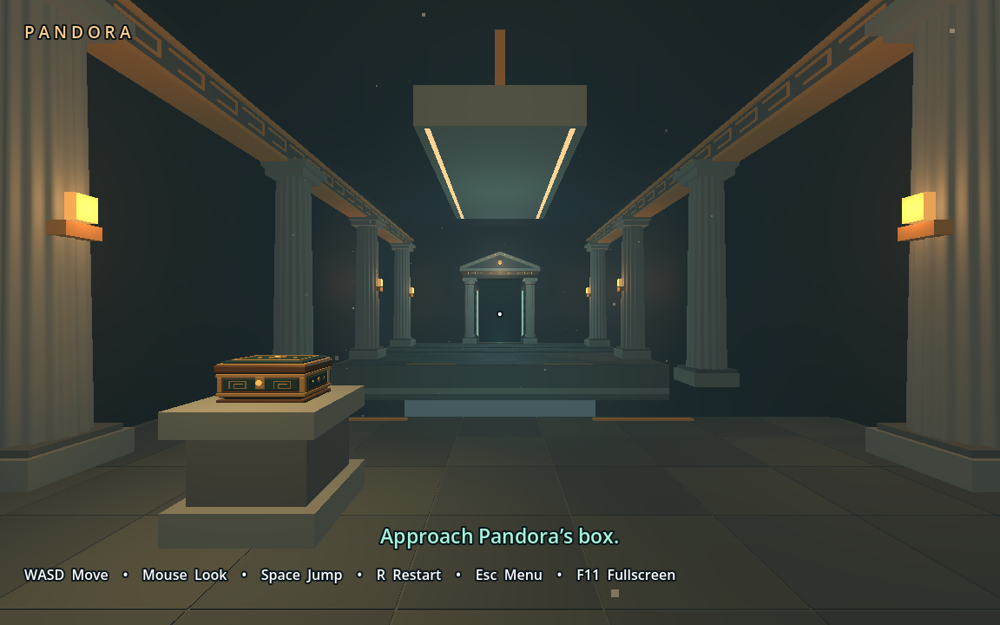

# Pandora: The Forbidden Gift

An original first-person 3D puzzle in which opening Pandora’s box drops a stone bridge across a temple chasm, while closing the lid makes the crossing safe.

[Download v1.0.1 for Windows x64](https://github.com/givi588/pandora-the-forbidden-gift/releases/download/v1.0.1/Pandora-The-Forbidden-Gift-v1.0.1-Windows.zip) · [Release notes and SHA-256 checksum](https://github.com/givi588/pandora-the-forbidden-gift/releases/tag/v1.0.1)



## Gameplay video

[Watch the 12-second walkthrough](https://github.com/user-attachments/assets/1a32faf0-f872-4d53-a1d5-d9da2477fac7) to see the box, bridge, and portal in the Windows release. [More gameplay screenshots, including the ending](art_previews/release-review.png).

## What you play

- Explore one temple chamber and use Pandora's box to change the path across the chasm.
- Read or skip the myth-inspired prologue. Reach the portal to see the cinematic ending, then replay or return to the menu.
- Adjust volume and display mode in Settings. Falls and unsafe crossings reset the puzzle.

## Install and play

Extract the Windows ZIP, run `Pandora.exe`, and select **Play**. The standalone build includes the engine notices. Use the build instructions below to try changes from a newer source revision.

| Input | Action |
| --- | --- |
| WASD / mouse / Space | Move / look / jump |
| E | Open or close the box when nearby |
| R | Restart the puzzle or replay after victory |
| Esc | Return to the main menu during play or the ending, go back from Settings, or skip the prologue |
| F11 | Toggle fullscreen |
| Left click | Capture the mouse during play |
| Tab or arrow keys / Enter | Navigate menus and the ending / activate the focused control |

## Development case study

**Objective.** Build one complete puzzle around Pandora's box, from the first playable chamber through the prologue, the ceremonial exit, and a standalone Windows release.

**Puzzle design.** Opening the box releases the suspended stone slab but keeps the bridge unsafe while the temple shakes. Closing the lid stops the tremors. The deterministic slab motion and fixed bridge collision let the room reset consistently after a failed crossing.

**Implementation.** The slab animation moves the visible mesh. A fixed collision shape becomes active when the slab lands, and the temple checks the lid state separately before allowing the crossing. This keeps resets deterministic and makes the amber and teal cues reflect the puzzle state.

**Procedural art.** [Blender 4.5.16 LTS Python tools](tools/blender/) generated the chest body, hinged lid, and ceremonial portal. Committed GLB exports supply the models and portal limestone texture to Godot.

## Architecture

The project runs in Godot 4.7.2 with GDScript and the Compatibility renderer.

| Script | Responsibility |
| --- | --- |
| [`main_menu.gd`](main_menu.gd) | Starts the game, handles the optional prologue, and reads and saves settings. |
| [`temple.gd`](temple.gd) | Coordinates input, puzzle state, bridge timing, on-screen cues, resets, and the victory trigger. |
| [`player.gd`](player.gd) | Handles first-person movement, jumping, mouse look, and camera shake. |
| [`temple_geometry.gd`](temple_geometry.gd) | Builds the room and its collision, assembles the imported models, and manages particles and lighting. |
| [`temple_audio.gd`](temple_audio.gd) | Plays ambience and puzzle cues, and fades room audio at the ending. |
| [`ending_screen.gd`](ending_screen.gd) | Runs the portal camera transition and presents replay and main-menu options. |

## Test and build from source

Open [project.godot](project.godot) in **Godot 4.7.2** to play from source. Run the regression suite from the project root with the same engine version. On Windows, use the console executable for terminal output.

```text
godot --headless --path . --editor --import
godot --headless --path . --script res://tests/menu_test.gd
godot --headless --path . --script res://tests/puzzle_test.gd
godot --headless --path . --script res://tests/ending_test.gd
```

The puzzle regression starts at the main menu and uses movement input to reach the portal. Run all three test commands without `--headless` for fullscreen, cursor, camera, audio, and layout assertions. The [GitHub Actions workflow](.github/workflows/godot-ci.yml) imports the project and runs all three headless tests.

For the exact release source, check out [v1.0.1](https://github.com/givi588/pandora-the-forbidden-gift/tree/v1.0.1). Install the matching [Godot 4.7.2 export templates](https://godotengine.org/download/archive/4.7.2-stable/), then use the checked-in Windows x64 preset and PowerShell. Here, `godot` refers to your Godot console executable.

```powershell
New-Item -ItemType Directory -Path dist/windows -Force | Out-Null
godot --headless --path . --editor --import
godot --headless --path . --export-release "Windows Desktop" dist/windows/Pandora.exe
$notices = Join-Path (Get-Location) 'dist/windows/GODOT-NOTICES.txt'
godot --headless --path . --script res://tools/write_engine_notices.gd -- $notices
Compress-Archive -Path dist/windows/* -DestinationPath dist/Pandora-local-Windows.zip
Get-FileHash -Algorithm SHA256 dist/Pandora-local-Windows.zip
```

Extract your ZIP to a fresh folder and launch `Pandora.exe` before distributing it. Verify the published download against the checksum attached to the release.

The GLB files are included. To regenerate a model, use a fresh staging directory and run `blender --background --factory-startup --python-exit-code 1 --python tools/blender/build.py -- TempleExit --export-dir <staging-path>`. Use `PandoraBox` to export the chest and lid. The tool also supports `--previews --preview-dir <preview-path>` for reviewing renders before export.

## Known limitations

Pandora is a single-room, keyboard-and-mouse game. The downloadable release targets Windows x64. The Linux CI job verifies headless game logic. Interactive Linux and macOS play and broader GPU compatibility remain unverified.

## Credits and licensing

Pandora is an original personal project directed and tested by [Givi Pruidze](https://github.com/givi588). Givi defined the concept, puzzle, and scope, reviewed iterations, and manually play-tested the published Windows build. OpenAI Codex assisted with GDScript implementation, automated tests, Blender Python modeling, synthesized audio, and release preparation.

Original source code is under the [MIT License](LICENSE). Original game artwork, models, textures, and audio are all rights reserved. See [asset rights and provenance](ASSET_RIGHTS.md) for details and the Windows ZIP for Godot's bundled third-party notices.
